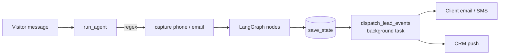

# Lead lifecycle, alerts and CRM sync

How a website visitor becomes an alert in the client's inbox and a record in
their CRM, and the guarantees each step makes.



## 1. Contact capture (`app/agent/contact.py`)

* A lead nobody can call back is worthless, so the agent asks for a **phone
  number or email** after the qualifying questions and **before scoring**.
* The question is fixed text (no LLM call, no hallucination) and mentions the
  business name.
* Phone/email are extracted by regex from **any** message, so a lead who
  volunteers them early is never asked again. Budgets like `$1,200,000` are
  never mistaken for phone numbers (10-15 digits required).
* If the lead declines ("skip", "I'd rather not"), `contact_declined` is set and
  the conversation continues; alerts then say *"lead chose not to share"*.
* `REQUIRE_CONTACT_INFO=false` turns the requirement off.

## 2. Booking confirmation (`app/agent/booking_intent.py`)

A meeting is confirmed **only** when:

1. the lead's message has no refusal/hesitation/question ("not sure", "don't
   want to book", "maybe", "can't", "?"), **and**
2. it names exactly one offered slot ("Wednesday at 10", "Oct 28 at 3pm"), **or**
   it is a bare "yes / sounds good" and the assistant's previous message
   pointed at exactly one slot.

Anything ambiguous is *not confirmed*, and the reply prompt is told so, so the
assistant never claims a meeting is booked when it is not. The system **never
defaults to the first slot**.

> The agent records the requested time and tells the office; it does **not**
> write to the client's calendar. The alert email includes an
> *Add to your calendar* link (Google Calendar) for one-click entry.

## 3. Alerts and CRM sync (`app/services/alerts.py`)

Run after the turn is saved, in a FastAPI background task (the visitor never
waits on email or CRM retries).

| Trigger                              | Fires                         | Marker column            |
|--------------------------------------|-------------------------------|--------------------------|
| `lead_status == hot`                 | "Hot lead" email (+SMS)       | `hot_alert_sent_at`      |
| `booking_confirmed`                  | "Meeting booked" email (+SMS) | `booking_alert_sent_at`  |
| `human_escalated`                    | "Handoff requested" email     | `handoff_alert_sent_at`  |
| CRM-relevant data changed            | CRM push                      | `crm_sync_hash`          |

Each marker is claimed with an atomic `UPDATE ... WHERE marker IS NULL
RETURNING`, so a side effect happens **at most once** even with concurrent
requests or several workers. Hot + booked in the same turn sends one email.
A CRM push repeats only when the data actually changed (e.g. the lead later
supplies a phone number or books).

## 4. Weekly client report (`app/services/weekly_report.py`)

Every Monday, each active, paid-up client gets: conversations, hot/warm/cold,
how many left contact details, meetings requested, handoffs, and the top leads
to call first with their phone/email.

```bash
python -m scripts.send_weekly_reports      # run from cron, Mondays 09:00 UTC
```

## Known limits (honest list)

* No calendar write-back; times are shown in UTC.
* CRM payload shapes for kvCORE / AMS360 / FUB contact fields must be verified
  against each vendor's current API docs before the first live client.
* `lead_conversations.session_id` is globally unique, not unique per tenant.
* Per-tenant Gemini default rate limit is 10 requests / minute.
